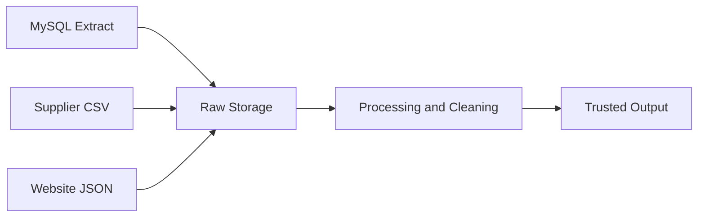
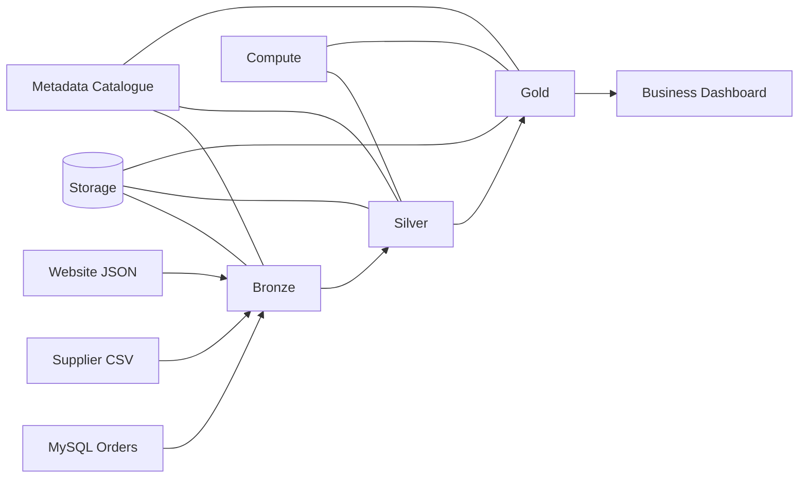

# BritMart — Week 2, Day 4 Lab Answers

**Topic:** Data Lake, Data Warehouse, and Lakehouse Architecture  
**Format:** One GitHub-ready Markdown file covering all 20 questions.

## Part 1 — Data Lake, Data Warehouse, and Lakehouse

### Q1. Choose the Better Platform

| Requirement | Choice | Reason |
|---|---|---|
| Keep large amounts of raw structured and semi-structured data | Data lake | Stores raw data in flexible formats. |
| Give analysts controlled SQL-ready business tables | Data warehouse | Designed for trusted, structured reporting. |
| Keep flexible storage while supporting governed table-style analytics | Lakehouse | Combines lake storage with managed analytical tables. |
| Keep raw website events for future use | Data lake | Preserves events before their final use is known. |

### Q2. Place BritMart Data

| Data | Placement | Reason |
|---|---|---|
| MySQL order extract | Data lake / lakehouse Bronze | Preserve the original extract. |
| Supplier CSV files | Data lake / lakehouse Bronze | Keep raw supplier files for later cleaning. |
| Website JSON events | Data lake / lakehouse Bronze | Store flexible semi-structured events. |
| Monthly finance table | Data warehouse / governed lakehouse table | Trusted, structured finance reporting. |
| Daily sales summary | Data warehouse / governed lakehouse Gold table | Ready for business analysis. |

### Q3. Compare the Three Architectures

| Area | Data Lake | Data Warehouse | Lakehouse |
|---|---|---|---|
| Raw data support | Strong | Usually not the main purpose | Strong |
| Strong structured reporting | Possible, with more design | Strong | Strong |
| Flexible data shapes | Strong | More controlled | Strong |
| Table-style analytics | Depends on tools and design | Strong | Strong |

### Q4. MCQ: Data Warehouse

**Answer: D.** Run controlled business reporting over trusted structured data.

## Part 2 — Schema, Bronze, and Silver

### Q5. Schema-on-Read or Schema-on-Write?

- **A:** Schema-on-read — store first, interpret when reading.
- **B:** Schema-on-write — check structure before accepting data.
- **C:** Schema-on-read — raw JSON can have optional fields.
- **D:** Schema-on-write — reporting tables enforce known columns and types.

### Q6. Design Bronze and Silver Rules

**Bronze:** Keep all received order records close to their original form, including `order_id`, `city`, `amount_gbp`, and `status`. Preserve them for inspection and reprocessing.

**Silver:** Check that `order_id` exists, keep positive `amount_gbp` values, trim extra spaces from `city`, and remove duplicate `order_id` records according to an agreed rule.

### Q7. Process Three Batches from Bronze to Silver (Pandas)

```python
import pandas as pd

columns = ["order_id", "city", "amount_gbp", "status"]

batch_1 = pd.DataFrame([
    (101, "London", 45.50, "complete"),
    (102, "Manchester", -5.00, "complete"),
], columns=columns)

batch_2 = pd.DataFrame([
    (103, " Bristol ", 30.00, "complete"),
    (104, "Leeds", 20.00, "cancelled"),
], columns=columns)

batch_3 = pd.DataFrame([
    (101, "London", 45.50, "complete"),
    (105, "Manchester", 51.00, "complete"),
], columns=columns)

# Bronze: preserve all input records.
bronze = pd.concat([batch_1, batch_2, batch_3], ignore_index=True)

# Silver: positive amounts, cleaned city names, unique order IDs.
silver = bronze[bronze["amount_gbp"] > 0].copy()
silver["city"] = silver["city"].str.strip()
silver = silver.drop_duplicates(subset=["order_id"], keep="first")

print("Bronze rows:", len(bronze))
print("Silver rows:", len(silver))
print(silver.to_string(index=False))
```

**Expected counts:** Bronze = **6** rows; Silver = **4** rows. Order 102 is removed because its amount is negative; the second occurrence of order 101 is removed as a duplicate. The cancelled order 104 remains in Silver because Q7 does not instruct us to remove cancelled orders.

### Q8. MCQ: Silver

**Answer: C.** A cleaned and deduplicated order row.

## Part 3 — Gold, Data Types, and Storage-First Architecture

### Q9. Build a Gold Summary (continuing from Q7)

```python
# Run after the Q7 code, using its silver DataFrame.
completed = silver[silver["status"] == "complete"]

gold = (
    completed.groupby("city", as_index=False)
    .agg(revenue_gbp=("amount_gbp", "sum"))
    .sort_values("revenue_gbp", ascending=False)
)

print(gold.to_string(index=False))
```

**Expected Gold result:**

| City | Revenue (GBP) |
|---|---:|
| Manchester | 51.00 |
| London | 45.50 |
| Bristol | 30.00 |

Leeds is excluded because its order is cancelled. Gold summarizes completed sales for reporting.

### Q10. Structured, Semi-Structured, or Unstructured?

| Source | Classification |
|---|---|
| MySQL orders table | Structured |
| JSON website event | Semi-structured |
| CSV supplier file | Structured |
| Product photo | Unstructured |
| PDF supplier contract | Unstructured |

### Q11. Design a Storage-First Flow



The three sources enter storage first. Processing happens afterward, producing trusted output. Keeping raw data makes it possible to reprocess it later.

### Q12. MCQ: Gold

**Answer: A.** Daily revenue by city for reporting.

## Part 4 — Compute, Storage, Metadata, and Catalogues

### Q13. Compute or Storage?

| Item | Classification |
|---|---|
| A. Files kept for later use | Storage |
| B. CPU and memory used to run a transformation | Compute |
| C. Stored analytical table data | Storage |
| D. Processing resources used for a query | Compute |

### Q14. Why Separate Compute and Storage?

BritMart can keep data stored all day without running expensive processing resources continuously. At night, it can increase compute power for the large transformation, then reduce it afterward. The stored data stays in place. This improves flexibility and can control costs.

### Q15. Create a Small Metadata Catalogue

| Dataset name | Purpose | Main columns | Source | Owner/team | Last known update |
|---|---|---|---|---|---|
| `bronze_orders` | Preserve received orders | `order_id`, `city`, `amount_gbp`, `status` | Source batches | Data Engineering | Not provided |
| `silver_orders` | Clean, reusable orders | `order_id`, `city`, `amount_gbp`, `status` | `bronze_orders` | Data Engineering | Not provided |
| `gold_daily_sales` | Business reporting summary | `city`, `revenue_gbp` | `silver_orders` | Analytics / Data | Not provided |

*Note:* The dataset owners are illustrative assignments, and actual update dates were not supplied in the lab. A real catalogue should record verified timestamps rather than invent them.

### Q16. MCQ: Metadata

**Answer: B.** Metadata describes data so people and systems can understand what it represents.

## Optional Practice

### Q17. Trace One Record Through Bronze, Silver, and Gold

- **Bronze:** `9001 | " London " | 50 | complete` — preserve the original value, including spaces.
- **Silver:** `9001 | London | 50 | complete` — trim spaces; valid record remains.
- **Gold:** The record adds **£50** to London's completed-sales revenue total. Gold may store the total rather than the original order row.

### Q18. Find a Layering Mistake

1. Different reports might clean the same raw data differently, producing inconsistent totals.
2. Invalid or duplicate rows might reach Gold, making business reports unreliable.

**Better approach:** Create one reusable, cleaned Silver layer before producing Gold reports.

### Q19. Reconcile the Layers

- Bronze rows: **1,000**
- Invalid amounts removed: **25**
- Duplicate rows removed: **15**
- Total removed: **25 + 15 = 40**
- Expected Silver rows: **1,000 − 40 = 960**

**Result:** Yes, the counts reconcile, assuming the 25 invalid rows and 15 duplicate rows represent separate removals.

### Q20. Design a Small Platform



| Component | Purpose |
|---|---|
| MySQL, CSV, JSON | Three different input source types. |
| Bronze | Preserve received raw records. |
| Silver | Validate, clean, and deduplicate data. |
| Gold | Produce business-ready sales summaries. |
| Storage | Keep raw, cleaned, and summarized data. |
| Compute | Run cleaning and aggregation jobs. |
| Metadata catalogue | Describe datasets, ownership, and sources. |
| Business dashboard | Display trusted Gold results to analysts. |

---

**Lab complete:** All 20 questions are answered in this single Markdown file. Q7 and Q9 contain Python/Pandas code; Q11 and Q20 contain GitHub-renderable Mermaid diagrams.
